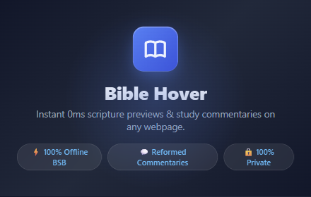

# Bible Hover 📖⚡

> Instant 0ms hover previews for Bible scripture references with multiple offline & online translations and classic commentaries.



Bible Hover transforms how you read the web by automatically recognizing biblical citations (e.g. *Romans 6:7*, *John 3:16*, *Psalm 23*) and displaying instant, rich scripture hover previews without navigating away from the page.

---

## ✨ Key Features

### ⚡ Instant 0ms Offline Engine
- **Pre-bundled Berean Standard Bible (BSB):** Renders in 0 milliseconds with zero network requests and zero latency.
- **Offline Storage Manager:** Download additional complete translations (such as the KJV) directly into local IndexedDB storage.
- **1-Click Management:** Easily inspect storage usage and remove downloaded offline versions anytime.

### 🌐 Multi-Translation & Global Languages
- **Core English Translations:** BSB, KJV, ESV, NIV, NLT, NASB, CSB, NKJV, and WEB.
- **International Languages:**
  - 🇺🇦 Ukrainian (TUR, UBIO)
  - 🇪🇸 Spanish (LBLA, RV1960)
  - 🇵🇹 Portuguese (NAA, ARA)
  - 🇩🇪 German (SCH2000)
  - 🇨🇳 Chinese (CUNPS, CUNP)
  - 🇰🇷 Korean (KRV)
  - 🇮🇳 Hindi (HIOV)
  - 🇷🇺 Russian (SYNOD, NRT)
- **Interactive Translation Pills:** Switch translations inside the preview card on the fly.

### 💬 Reformed & Classic Commentaries
Integrated study resources featuring leading biblical scholars and classic commentators:
- **Matthew Henry** Exposition of the Old and New Testaments
- **John Calvin** Commentaries
- **Jamieson-Fausset-Brown (JFB)** Critical and Explanatory Commentary
- **Alexander MacLaren** Expositions of Holy Scripture
- **John Gill** Exposition of the Entire Bible
- **Geneva Study Bible (1599)** Historical Reformers' Notes
- **The Gospel Coalition (TGC)** Contemporary Commentary Series

Choose from **4 commentary presentation styles**:
1. **Direct 1-Click Link:** Quick-access link to chapter/verse commentary.
2. **In-Card Interactive Tab:** Scrollable commentary tabs right inside the hover card.
3. **Multi-Action Resource Pills:** Multiple study buttons (Commentaries, TGC, TheSinging.Bible audio, YouTube sermons).
4. **Side Drawer Reader:** Slide-out reading drawer to view study notes without leaving the article.

### 🎨 Custom Typography & Accessibility
- **Scripture-Only Styling:** Font customization applies specifically to the scripture verse text body, preserving crisp system UI chrome for buttons, pills, and headers.
- **Typography Stacks:**
  - **Modern Sans (Default):** Clean, neutral contemporary reading.
  - **Classic Bible Serif (Georgia):** Traditional printed Bible aesthetic.
  - **Elegant Garamond:** Warm, distinguished book typography.
  - **Humanist Sans (Calibri):** Soft, rounded, easy on the eyes.
  - **Dyslexia-Friendly:** Research-backed stack (`OpenDyslexic`, `Comic Sans`, `Verdana`) with **+0.04em letter-spacing**, **+0.08em word-spacing**, and **1.82 line-height** to reduce visual crowding.
  - **Study Monospace:** Fixed-width typography for analytical study.
- **Color Themes:** Auto (system match), Crisp Light, OLED Dark, and Warm Sepia.
- **Minimalist Mode:** Pure scripture only, removing all buttons and chrome for distraction-free reading.

### 🔒 100% Private & Open
- **Zero Tracking:** No analytics, no telemetry, no cookies, no third-party trackers.
- **Local Storage:** All user preferences and cached translations stay strictly on your device.

---

## 🛠 Installation & Local Development

### Load in Google Chrome / Brave / Edge:
1. Clone this repository:
   ```bash
   git clone https://github.com/Aussie-App-Studio/Bible-Hover.git
   ```
2. Open your browser and navigate to `chrome://extensions/`.
3. Enable **Developer mode** (toggle in top-right corner).
4. Click **Load unpacked** and select the `extension/` directory.

### Build Production Package:
Run the PowerShell packager to generate a clean, store-ready ZIP in `dist/`:
```powershell
.\package_extension.ps1
```

---

## 📂 Project Structure

```text
├── extension/
│   ├── manifest.json            # Manifest V3 extension configuration
│   ├── data/
│   │   └── bsb.json             # Bundled Berean Standard Bible (offline 0ms)
│   ├── icons/                   # Extension icons (16, 32, 48, 128px)
│   ├── options/                 # Full-tab settings dashboard & live preview
│   ├── popup/                   # Compact popup interface
│   ├── scripts/
│   │   ├── background.js        # Service worker (offline cache & network fetch)
│   │   └── content.js           # DOM citation parser, shadow DOM hover card, drawer
│   └── shared/
│       └── bible-metadata.js    # Bible book canon, regex patterns, book metadata
├── store_assets/                # Chrome Web Store screenshots, banners, privacy policy
├── dist/                        # Packaged production release ZIP
├── package_extension.ps1        # Packaging automation script
└── README.md
```

---

## 📄 License
MIT License. See [LICENSE](LICENSE) for details.
